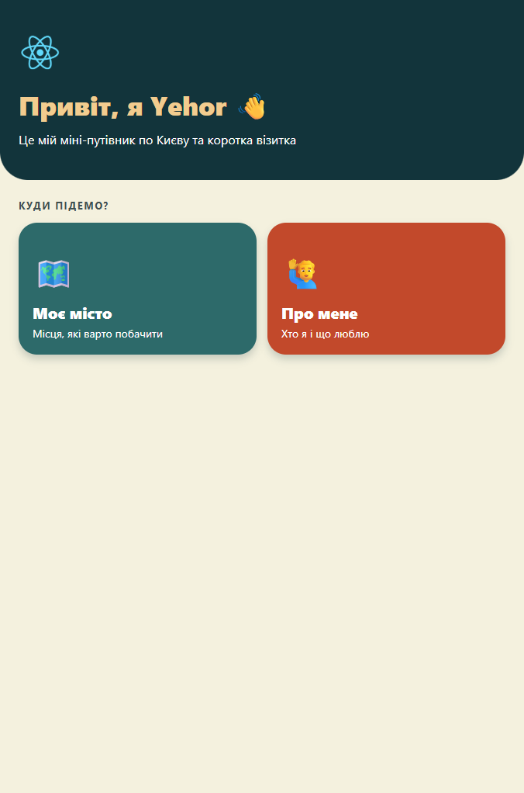
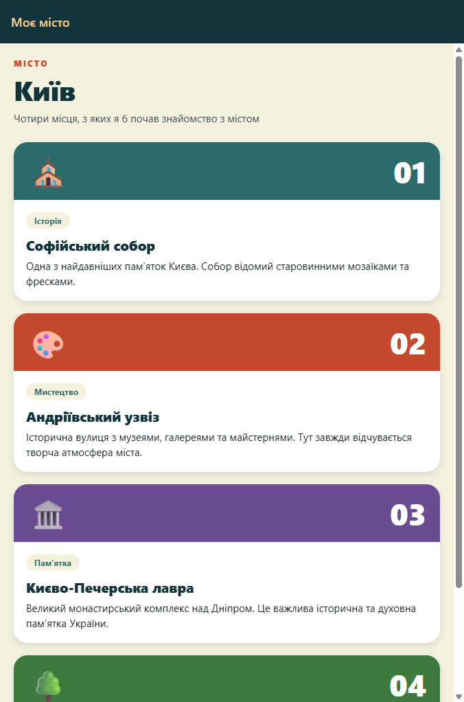
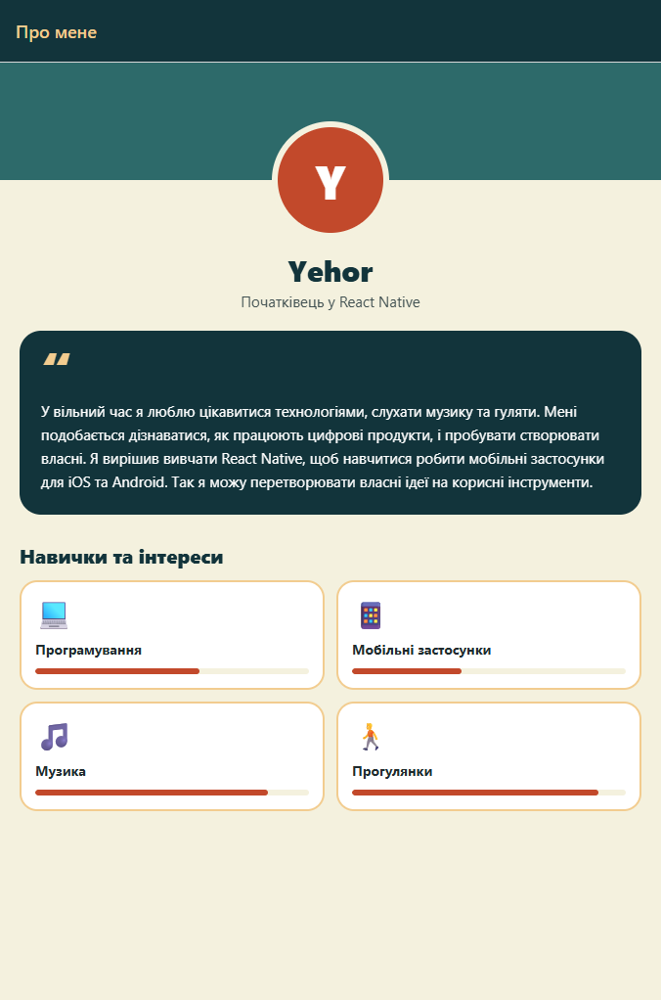

# Моє місто — домашнє завдання (Модуль 1)

Мобільний застосунок на **React Native + Expo Router** з трьома екранами: головна, «Моє місто» та «Про мене».

## Скріншоти

| Головна | Моє місто | Про мене |
| :---: | :---: | :---: |
|  |  |  |

## Що реалізовано

- **Головна (`src/app/index.tsx`)** — дві кнопки-плитки з `Link` з `expo-router`: «Моє місто» → `/city`, «Про мене» → `/about`.
- **Моє місто (`src/app/city.tsx`)** — список із 4 визначних місць Києва (назва та опис) через `FlatList`; кожне місце — картка з кольоровою шапкою, емоджі-іконкою і тінню.
- **Про мене (`src/app/about.tsx`)** — ім'я, аватар, короткий опис (5 речень) та 4 інтереси з іконками в картках.
- **Стилі** — єдина палітра в `src/theme.ts` (темно-бірюзовий, кораловий, пісочний на кремовому тлі), різні розміри шрифтів для заголовків, підзаголовків і тексту, усі стилі в `StyleSheet.create()`.

## Запуск

```bash
npm install
npm start
```

Далі натисніть `w` для веб-версії або відскануйте QR-код у застосунку Expo Go.

Перевірка типів: `npm run typecheck`.

## Структура

```
assets/        іконки та зображення Expo
screenshots/   скріншоти екранів
src/app/       екрани (expo-router)
src/theme.ts   кольори
report.txt     звіт
```
